# Command Center: getting started

Command Center is your own small home page on your PC: weather, to-do, shopping list, reminders to your phone and your notes. Everything stays on your PC.

It takes about ten minutes. You need the PC, your phone and your Wi-Fi. (The pictures show the Swedish screens; the English ones look the same.)

## 1. Install

1. Download `CommandCenter-Setup-….exe` and double-click it.
2. Windows says **"Windows protected your PC"**. It says that for every program that hasn't bought a certificate from Microsoft. Click **More info**…

   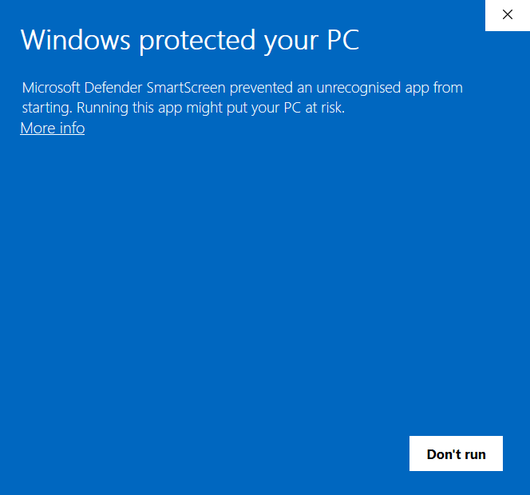

3. …then **Run anyway**.

   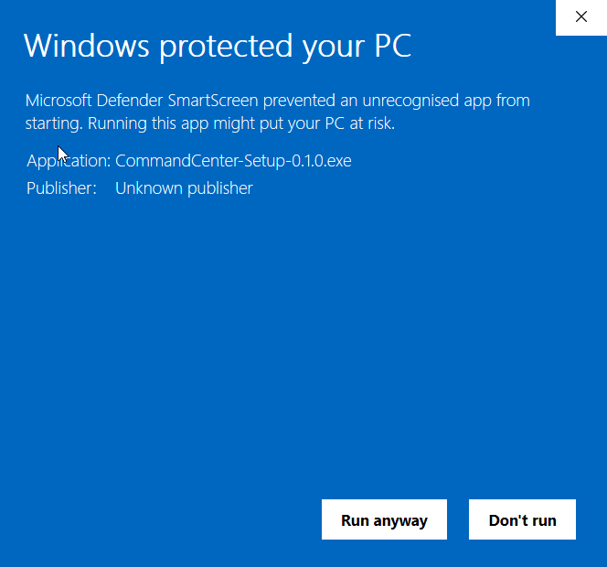

4. Windows asks whether the app may make changes. Click **Yes** (it installs a service that starts with the PC).

   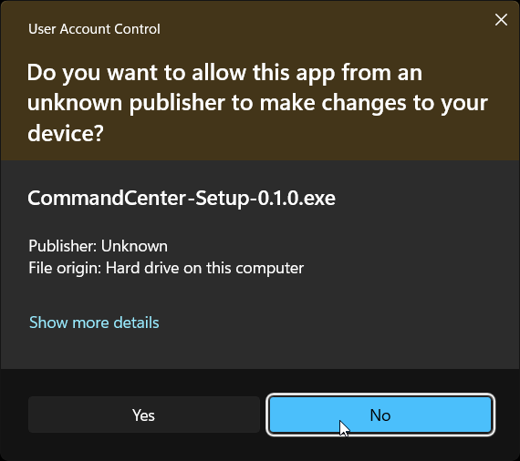

5. Click **Install**, then **Finish** with "Open Command Center" ticked.

   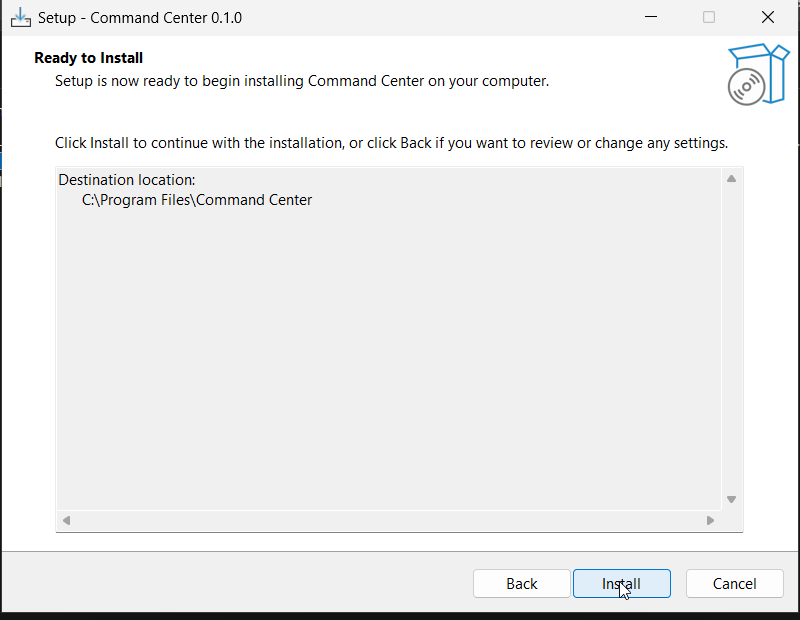 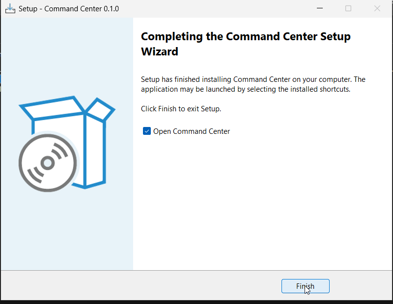

## 2. Set up (ten short steps)

Command Center opens in its own window. Follow the steps:

| Step | What you do |
|---|---|
| Language | Pick **English**. 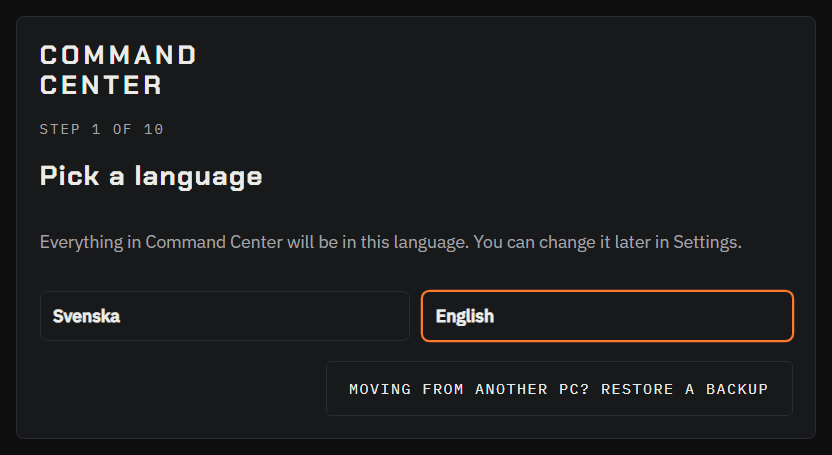 |
| Look | Pick colours. You can change them later. 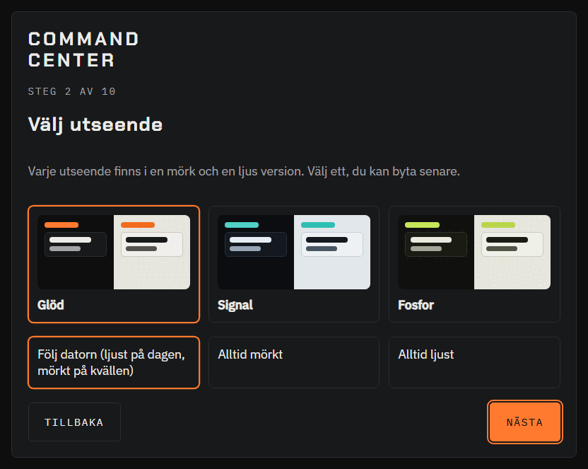 |
| Where do you live? | Type your town and click it in the list (for the weather). 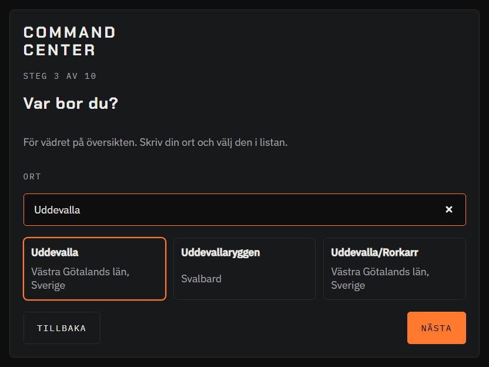 |
| Name and password | One password for the whole household, on the PC and on phones. 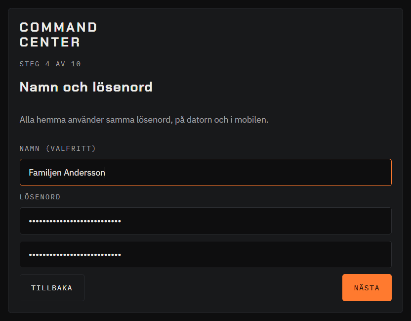 |
| Recovery code | **Print it or write it down** and keep it safe. If you forget the password, it's the only way back in. 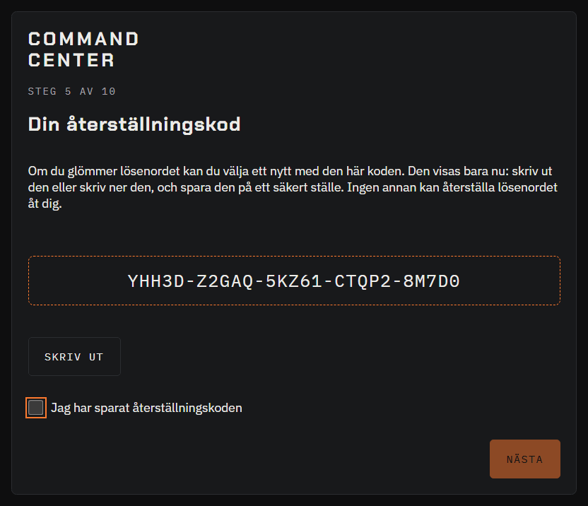 |
| Notes | Leave "A new vault" picked and click NEXT. 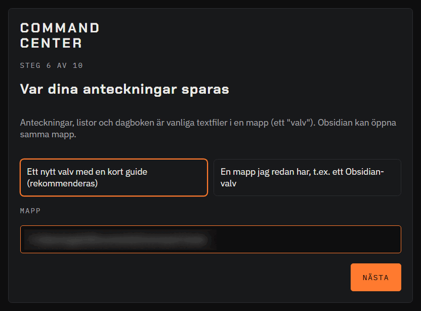 |
| Backups | Click **OneDrive** or a **USB drive** if you have one. "On this PC" is the weakest: if the disk breaks, the backups go too. 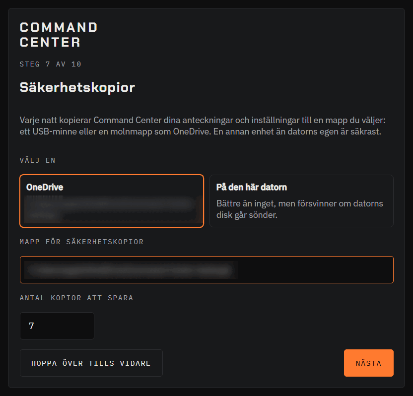 |
| Open on your phone | Pick **Yes, allow phones on our Wi-Fi** and scan the code with the phone's camera. If it says the network is "public": click **MAKE IT PRIVATE** (only at home). 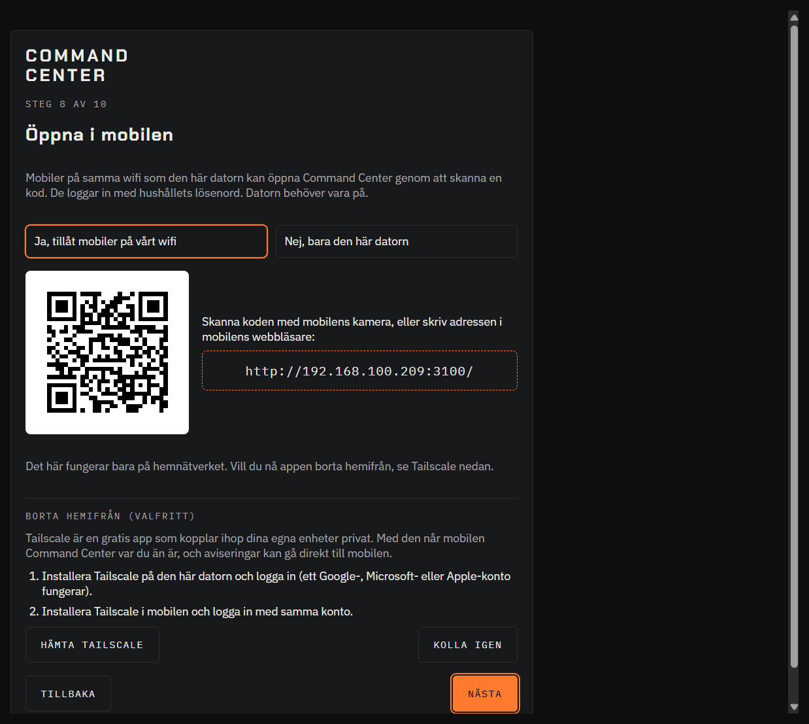 |
| Notifications | Easiest: **the ntfy app** (a free phone app, two QR codes). Skipping is fine too. 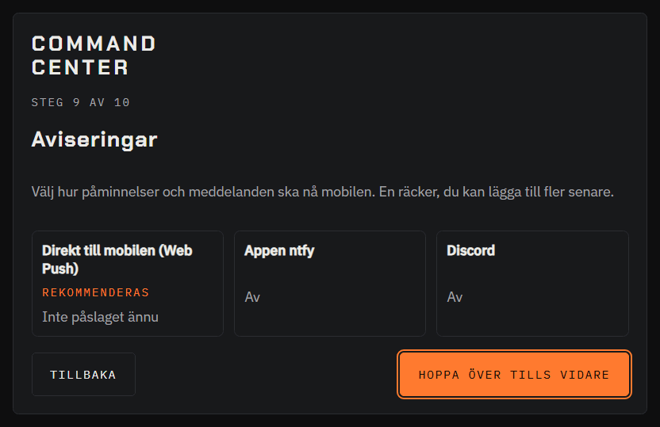 |
| Done | Click **OPEN COMMAND CENTER**. 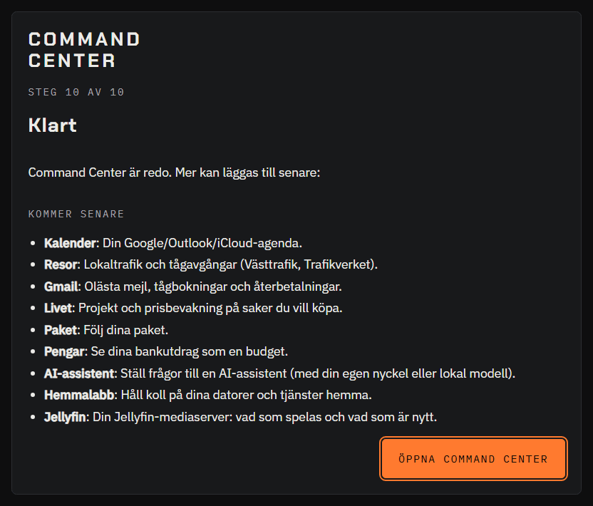 |

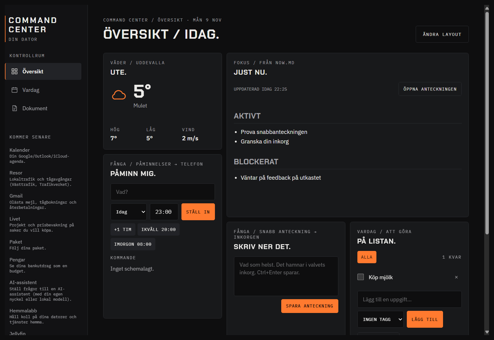

## 3. On your phone

- Scan the code from the **Open on your phone** step (also under **Settings → Phone**) and log in with the password.
- Put it on the home screen: in Chrome tap **⋮ → Add to Home screen**, on iPhone **Share → Add to Home Screen**.
- The phone reaches Command Center only at home on Wi-Fi. Away from home you need Tailscale (see Settings → Phone).

## 4. Good to know

- **The PC needs to be on** for the phone and reminders to work. A reminder that was due while the PC slept arrives when it wakes, saying when it was due.
- **Forgot the password?** Click "Forgot the password?" and type the recovery code.
- **New versions:** Command Center checks once a day by itself. When a new version is out, a bar shows at the top of the app (and a message on your phone). Click the bar, then **UPDATE NOW**. The PC takes a backup first, and after a minute the window is back on the new version.
- **Backups** are taken every night. Under **Settings → Backups** you can take one now or restore an older one.
- **New PC?** Install on the new one and pick **Moving from another PC? Restore a backup** on the first page. You need the recovery code.
- **"Command Center isn't answering yet"** in the window: wait a minute. If it stays, restart the PC.
- **Something wrong?** **Settings → Diagnostics → SAVE FILE**, and send the file to whoever helps you. It holds no passwords or notes.

## 5. Remove it

**Windows Settings → Apps → Installed apps → Command Center → Uninstall.** You choose:

- **Keep** (the default): your settings are still there if you install again.
- **Remove everything**: a last backup is taken first.

Your notes and backups are **never** deleted. The last box shows where they are. Also remove the icon from your phone's home screen.

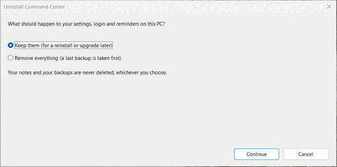 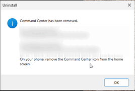
