# Command Center: så kommer du igång

Command Center är din egen lilla startsida på datorn: väder, att göra, inköpslista, påminnelser till mobilen och dina anteckningar. Allt stannar på din dator.

Det tar ungefär tio minuter. Du behöver datorn, mobilen och ert wifi.

## 1. Installera

1. Ladda ner `CommandCenter-Setup-….exe` och dubbelklicka på den.
2. Windows säger **"Windows skyddade datorn"**. Det står så för alla program som inte köpt ett certifikat från Microsoft. Klicka på **Mer information**…

   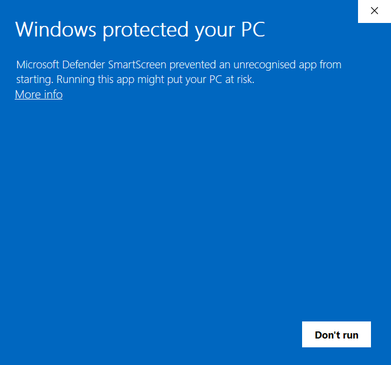

3. …och sedan på **Kör ändå**.

   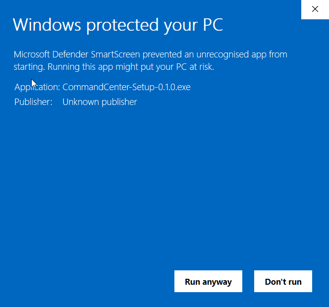

4. Windows frågar om appen får göra ändringar. Klicka **Ja** (den installerar en tjänst som startar med datorn).

   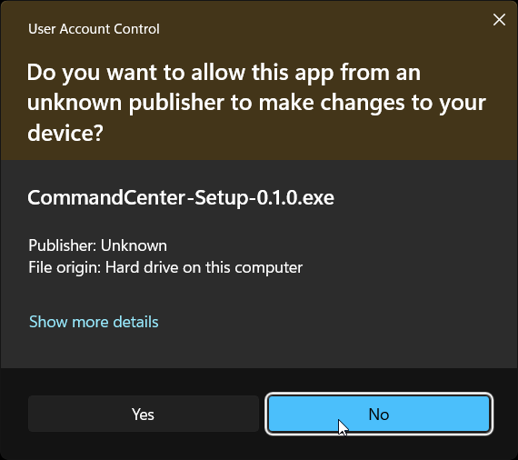

5. Klicka **Installera**, och sedan **Slutför** med "Öppna Command Center" ikryssat.

   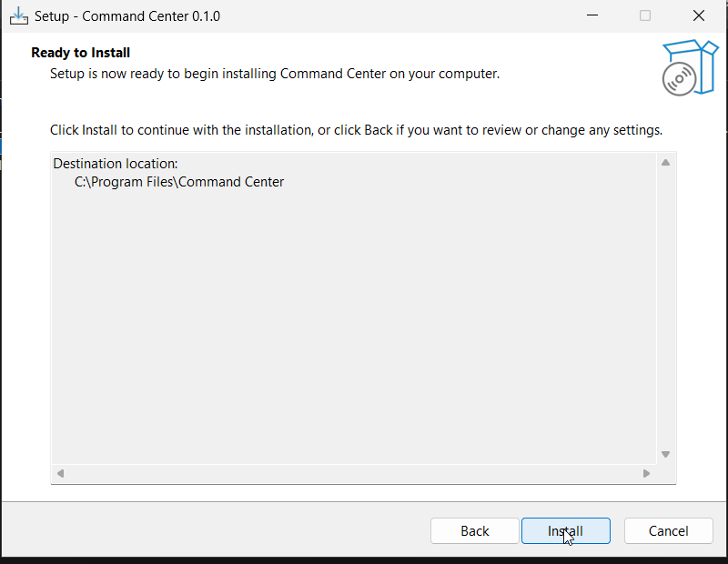 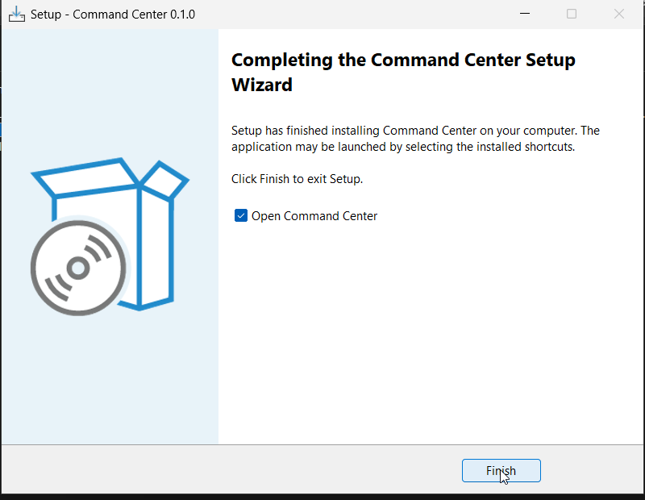

## 2. Ställ in (tio korta steg)

Command Center öppnas i ett eget fönster. Följ stegen:

| Steg | Vad du gör |
|---|---|
| Språk | Välj **Svenska**. 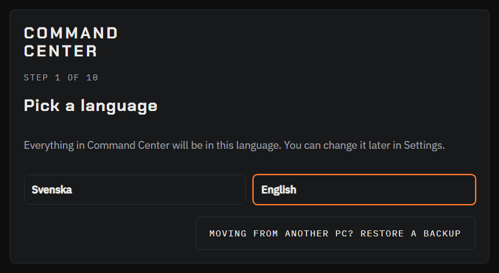 |
| Utseende | Välj färger. Du kan byta senare. 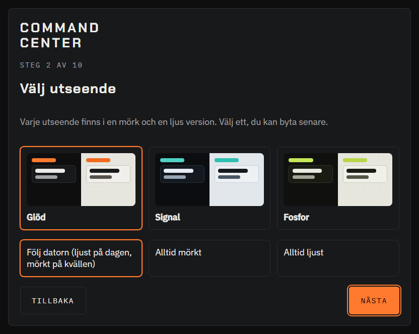 |
| Var bor du? | Skriv din ort och klicka på den i listan (för vädret). 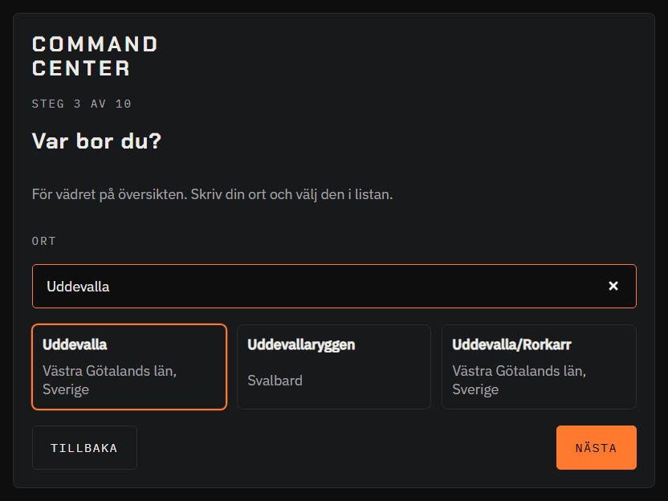 |
| Namn och lösenord | Ett lösenord för hela hushållet, på datorn och i mobilen. 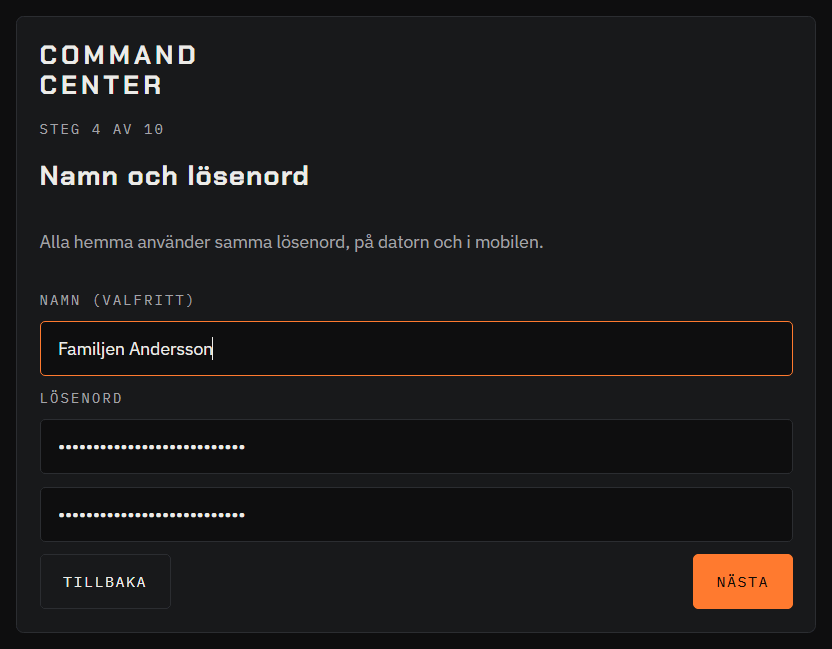 |
| Återställningskod | **Skriv ut den eller skriv av den** och spara den. Glömmer du lösenordet är det enda sättet in igen. 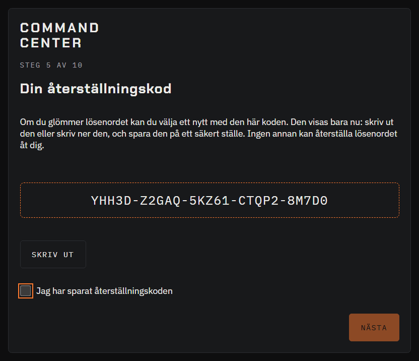 |
| Anteckningar | Låt "Ett nytt valv" vara valt och klicka NÄSTA. 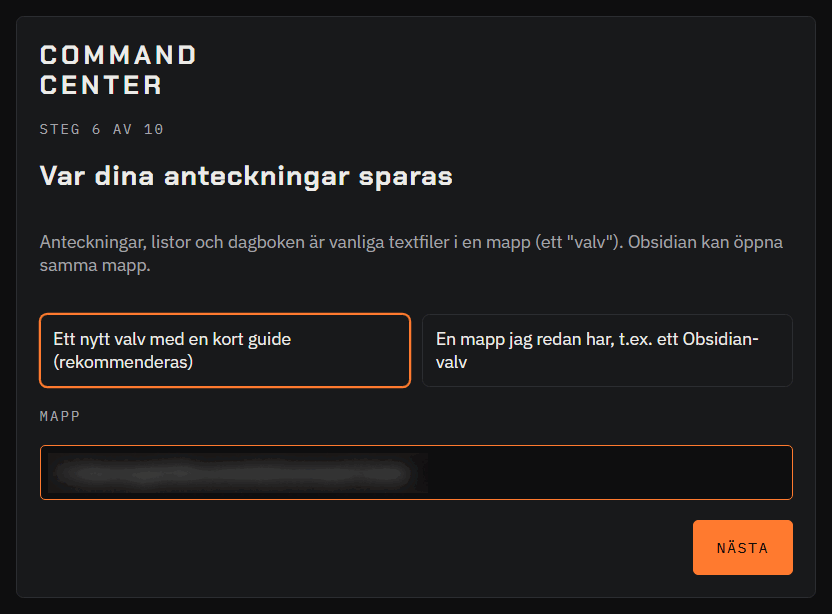 |
| Säkerhetskopior | Klicka på **OneDrive** eller ett **USB-minne** om de finns. "På den här datorn" är sämst: går disken sönder försvinner kopiorna också. 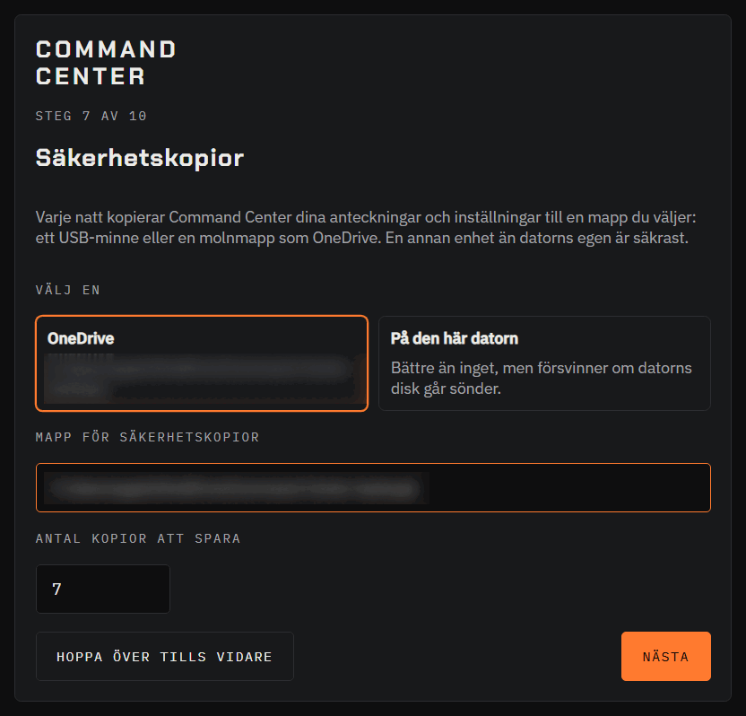 |
| Öppna i mobilen | Välj **Ja, tillåt mobiler på vårt wifi** och skanna koden med mobilens kamera. Står det att nätverket är "offentligt": klicka **GÖR DET PRIVAT** (bara hemma). 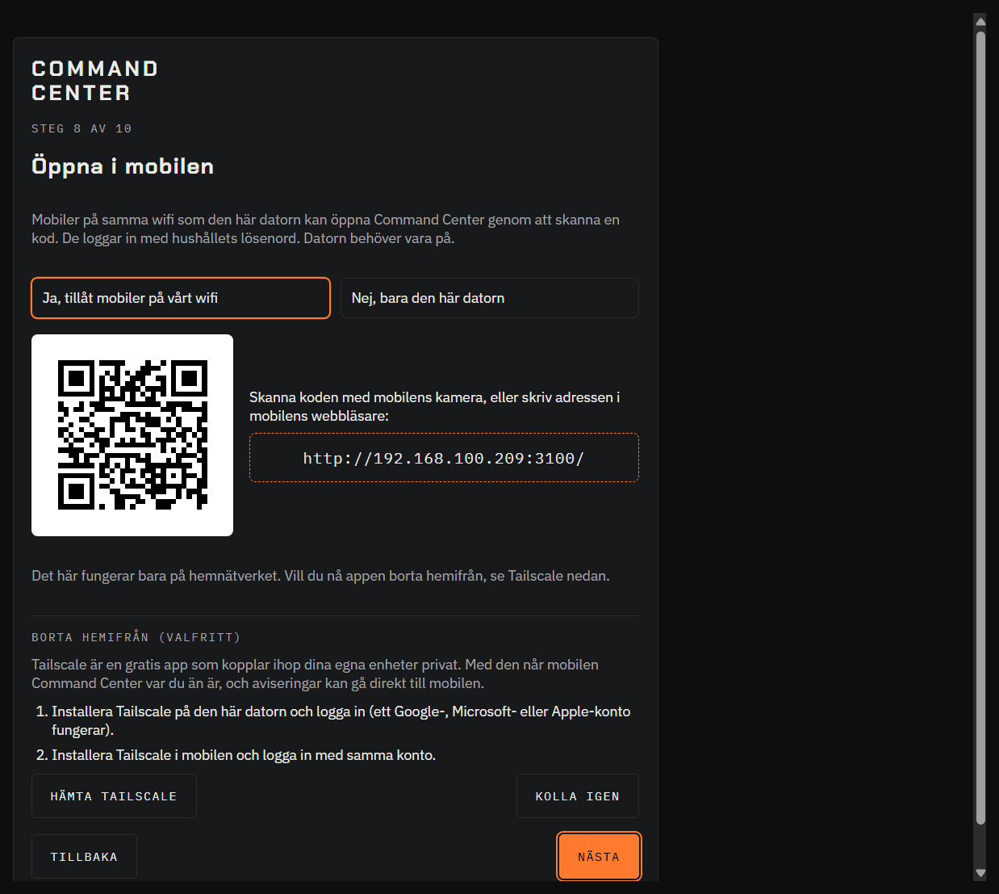 |
| Aviseringar | Enklast: **Appen ntfy** (gratis app i mobilen, två QR-koder). Hoppa över går också. 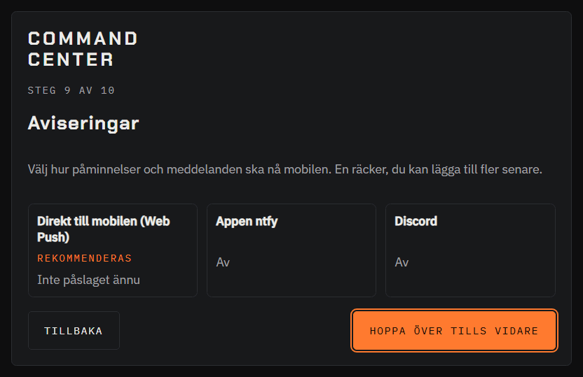 |
| Klart | Klicka **ÖPPNA COMMAND CENTER**. 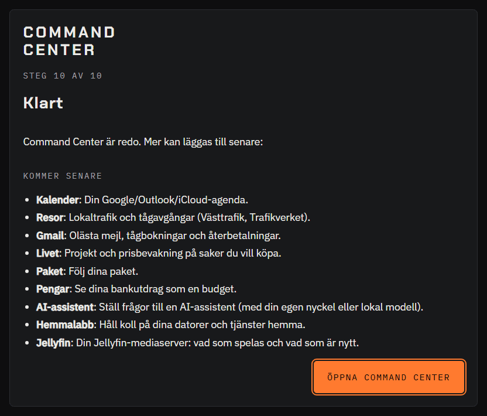 |

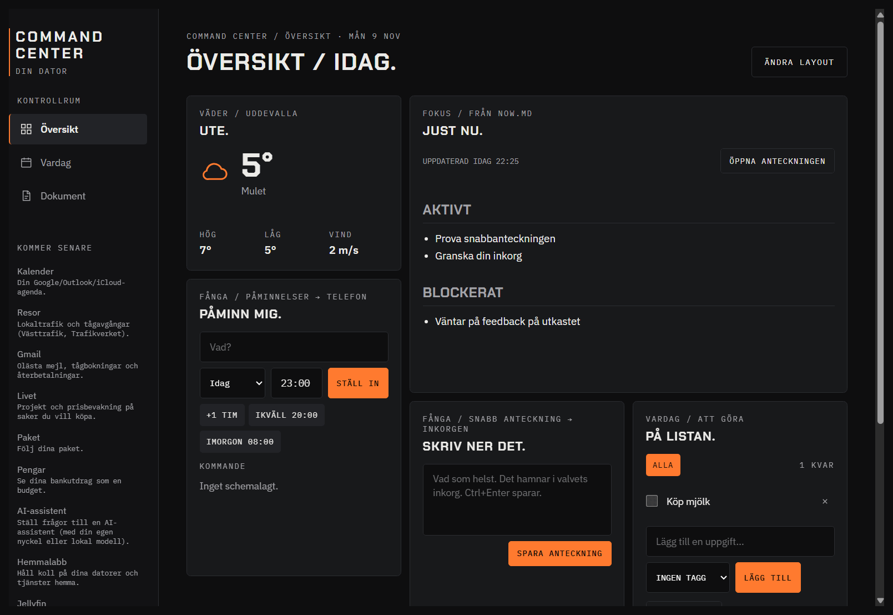

## 3. I mobilen

- Skanna koden från steget **Öppna i mobilen** (finns kvar under **Inställningar → Mobilen**) och logga in med lösenordet.
- Lägg den på hemskärmen: i Chrome trycker du på **⋮ → Lägg till på startskärmen**, på iPhone **Dela → Lägg till på hemskärmen**.
- Mobilen når Command Center bara hemma på wifi. Borta hemifrån behövs Tailscale (se Inställningar → Mobilen).

## 4. Bra att veta

- **Datorn behöver vara på** för att mobilen och påminnelserna ska fungera. En påminnelse som skulle ha kommit när datorn sov kommer när den vaknar, med tiden den skulle ha kommit.
- **Glömt lösenordet?** Klicka på "Glömt lösenordet?" och skriv återställningskoden.
- **Nya versioner:** Command Center kollar själv en gång om dagen. När en ny version finns syns en rad överst i appen (och ett meddelande i mobilen). Klicka på raden och sedan **UPPDATERA NU**. Datorn tar en säkerhetskopia först, och efter en minut är fönstret tillbaka med den nya versionen.
- **Säkerhetskopior** tas varje natt. Under **Inställningar → Säkerhetskopior** kan du ta en direkt eller återställa en gammal.
- **Ny dator?** Installera på den nya och välj **Flyttar du från en annan dator? Återställ en säkerhetskopia** på första sidan. Du behöver återställningskoden.
- **"Command Center svarar inte än"** i fönstret: vänta en minut. Står det kvar, starta om datorn.
- **Något krånglar?** **Inställningar → Felsökning → SPARA FIL**, och skicka filen till den som hjälper dig. Den innehåller inga lösenord eller anteckningar.

## 5. Ta bort

**Inställningar i Windows → Appar → Installerade appar → Command Center → Avinstallera.** Du får välja:

- **Behåll** (förvalt): dina inställningar finns kvar om du installerar igen.
- **Ta bort allt**: en sista säkerhetskopia tas först.

Dina anteckningar och säkerhetskopior tas **aldrig** bort. Sista rutan visar var de finns. Ta också bort ikonen från mobilens hemskärm.

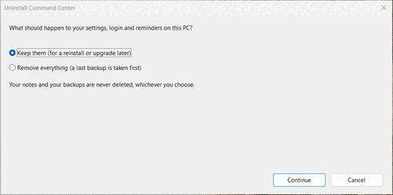 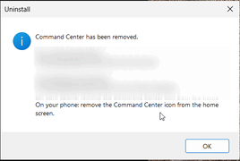
